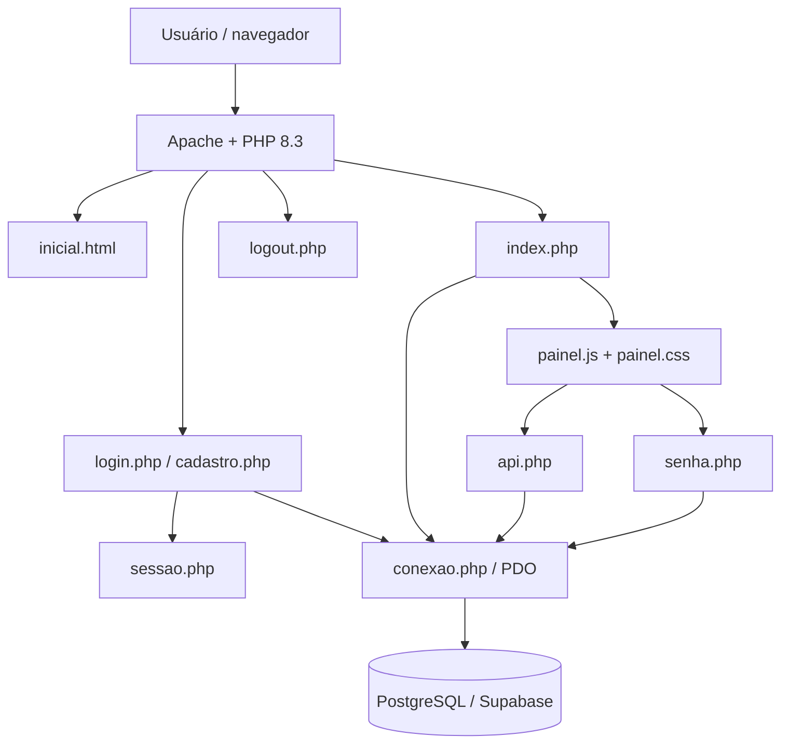

# Arquitetura e funcionamento

Este documento descreve a aplicação MeuDia+ que é executada pela imagem Docker definida na raiz do repositório.

## 1. Visão geral

O MeuDia+ é uma aplicação web monolítica: o Apache entrega os arquivos estáticos e executa os scripts PHP; o PHP valida as requisições e conversa com o PostgreSQL; o JavaScript executa as interações do painel no navegador.



A sessão PHP identifica o usuário autenticado. O painel consulta apenas as linhas de dados cujo `usuario_id` corresponde ao ID salvo nessa sessão.

## 2. Tecnologias e responsabilidades

| Componente | Responsabilidade |
|---|---|
| Apache | Servir a aplicação HTTP dentro do contêiner. |
| PHP 8.3 | Executar autenticação, validações, páginas e API. |
| PDO_PGSQL | Conectar ao PostgreSQL com consultas preparadas. |
| PostgreSQL | Armazenar usuários, dados do painel e tentativas de login. |
| HTML | Estrutura da página inicial, autenticação e painel. |
| CSS | Layout, responsividade, identidade visual e transições. |
| JavaScript | Navegação interna, manipulação dos módulos, busca, tema, CSV e envio de dados à API. |
| Docker | Reproduzir o ambiente PHP/Apache com as extensões necessárias. |

A interface não utiliza framework JavaScript. O código do painel é organizado em funções no arquivo `painel.js`.

## 3. Fluxo de navegação

1. A raiz do servidor abre `inicial.html`, configurada como primeira opção de `DirectoryIndex` no Dockerfile.
2. A página pública oferece acesso ao cadastro e ao login.
3. `cadastro.php` valida os campos e cria um usuário.
4. `login.php` verifica as credenciais e cria a sessão autenticada.
5. Após o login, o navegador é direcionado a `index.php`.
6. `index.php` verifica a sessão, carrega os dados do usuário e monta o painel.
7. `painel.js` atualiza os dados localmente na interface e envia as alterações para `api.php`.
8. O usuário pode alterar a senha em `senha.php` ou encerrar a sessão em `logout.php`.

## 4. Páginas e endpoints

| Caminho | Método | Acesso | Função |
|---|---|---|---|
| `/inicial.html` | GET | Público | Página de apresentação e entrada no sistema. |
| `/cadastro.php` | GET / POST | Público | Exibe o formulário e cria uma conta. |
| `/login.php` | GET / POST | Público | Exibe o formulário e autentica por e-mail e senha. |
| `/index.php` | GET | Autenticado | Carrega o painel e os dados da conta atual. |
| `/api.php` | POST JSON | Autenticado | Cria ou atualiza uma coleção de dados do painel. |
| `/senha.php` | POST JSON | Autenticado | Valida a senha atual e grava a nova senha. |
| `/logout.php` | GET | Autenticado | Destrói a sessão e redireciona ao login. |

As páginas PHP principais usam arquivos compartilhados: `sessao.php` para sessão e `conexao.php` para conexão com o banco.

## 5. Módulos funcionais do painel

### Início / resumo

Apresenta saudação, data atual, indicadores e atalhos para informações relevantes, como tarefas próximas e resumo financeiro.

### Tarefas

Permite adicionar tarefas, definir prioridade e prazo, marcar como concluídas e remover itens.

### Agenda

Permite registrar compromissos com nome, data, hora e local, além de listar e excluir eventos.

### Anotações

Mantém notas com título e texto, com ações para adicionar e excluir.

### Finanças

Mantém a renda do usuário e os gastos registrados. Os gastos incluem descrição, valor e categoria. O painel calcula renda, gastos e saldo, apresenta agrupamento por categoria e histórico.

### Compras

Permite adicionar produtos, marcar itens como concluídos e remover itens da lista.

### Estudos

Registra matéria, atividade e data de estudo, com marcação de conclusão e exclusão.

### Trabalho

Registra atividades profissionais, data e observações, além de permitir concluir e remover itens.

### Emergência

A interface contém atalhos informativos para Polícia, SAMU, Bombeiros, PRF, Defesa Civil e Disque-Denúncia. Os atalhos são elementos da interface; não representam integração com serviços externos.

### Perfil e conta

O perfil armazena nome, cidade, profissão, objetivo e apresentação pessoal. A área de conta também oferece tema claro/escuro, alteração de senha e exportação CSV.

### Busca

A busca é executada no navegador sobre as coleções já carregadas na sessão do painel. Ela não representa uma busca global no banco.

## 6. Persistência dos dados

O painel utiliza um modelo chave/valor por usuário. A tabela `dados_usuario` contém uma linha para cada coleção ou preferência salva:

| Coluna | Significado |
|---|---|
| `usuario_id` | Identificador da conta proprietária. |
| `chave` | Nome do conjunto de dados ou preferência. |
| `valor` | Conteúdo serializado em JSON, armazenado como texto. |
| `atualizado_em` | Data e hora da última gravação. |

A chave primária composta `(usuario_id, chave)` impede duas linhas da mesma chave para o mesmo usuário. O endpoint `api.php` usa `INSERT ... ON CONFLICT ... DO UPDATE`, portanto a primeira gravação cria a linha e as próximas atualizam o valor.

As chaves aceitas pela API são:

- Coleções: `tarefas`, `agenda`, `notas`, `gastos`, `compras`, `estudos`, `trabalhos`.
- Valores e perfil: `renda`, `nome`, `cidade`, `profissao`, `objetivo`, `sobre`.
- Preferências: `tema`.

O endpoint rejeita chaves que não estejam nessa lista e limita cada valor JSON a 1.000.000 de bytes.

## 7. Contrato da API de dados

### Requisição

`POST /api.php`

Cabeçalho obrigatório:

```http
Content-Type: application/json
```

Corpo:

```json
{
  "chave": "tarefas",
  "valor": [
    {
      "id": "identificador-do-item",
      "texto": "Exemplo de tarefa",
      "concluida": false
    }
  ]
}
```

O exemplo ilustra o formato geral. Os campos internos de cada coleção são definidos pelo JavaScript do painel.

### Respostas principais

| HTTP | Situação |
|---:|---|
| 200 | Dados salvos: `{"ok": true}`. |
| 400 | JSON inválido, chave não permitida ou valor inválido. |
| 401 | Usuário sem sessão autenticada. |
| 405 | Método diferente de POST. |
| 415 | Tipo de conteúdo diferente de JSON. |
| 500 | Falha interna ao gravar os dados. |

Quando a sessão expira, o JavaScript informa o usuário e redireciona para a tela de login.

## 8. Contrato da alteração de senha

`POST /senha.php`

Corpo JSON:

```json
{
  "atual": "senha-atual",
  "nova": "nova-senha"
}
```

A rota exige sessão, valida a senha atual com `password_verify`, gera o novo hash com `password_hash` e regenera o ID da sessão após a alteração.

## 9. Organização dos arquivos ativos

| Arquivo | Responsabilidade |
|---|---|
| `inicial.html` | Página pública inicial. |
| `login.php` | Autenticação do MeuDia+. |
| `cadastro.php` | Criação de conta do MeuDia+. |
| `index.php` | Renderização do painel autenticado. |
| `conexao.php` | Leitura das variáveis de ambiente e conexão PostgreSQL. |
| `sessao.php` | Configuração e inicialização da sessão. |
| `api.php` | Persistência das coleções e preferências. |
| `senha.php` | Alteração de senha. |
| `logout.php` | Encerramento da sessão. |
| `painel.js` | Lógica dos módulos, estado, busca, tema e exportação CSV. |
| `painel.css` | Estilos do painel. |
| `auth.js` | Interações auxiliares de autenticação, como exibição e avaliação da senha. |
| `auth-page.css`, `style.css`, `estilo.css`, `principal.css`, `transicao.css` | Folhas de estilo usadas por telas e protótipos diferentes. |
| `transicao.js` | Transições animadas entre links marcados para esse comportamento. |
| `logo.png` | Marca visual utilizada pelas páginas. |

## 10. Observações de implementação

- A autenticação atual do MeuDia+ está em `projetointegrador/login.php`; o `login.php` existente na raiz do repositório é antigo e não é copiado pelo Dockerfile.
- O código principal usa PostgreSQL. Os arquivos antigos do VALORIZA+ utilizam outro modelo de autenticação e MySQL; veja [LEGADO-VALORIZA.md](LEGADO-VALORIZA.md).
- Não foram encontrados testes automatizados, scripts de migração versionados para PostgreSQL ou configuração `render.yaml` na árvore analisada.
- O arquivo `projetointegrador/database.sql` é um esquema MySQL anterior e não deve ser executado no PostgreSQL sem conversão.
