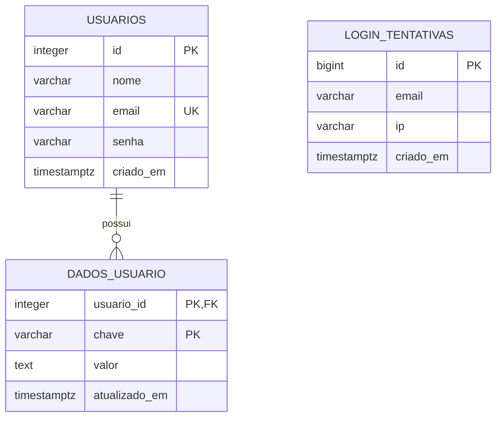

# Banco de dados

## 1. Banco utilizado pela aplicação principal

O MeuDia+ utiliza **PostgreSQL** por meio de PDO e da extensão PHP `pdo_pgsql`. O código de conexão está em `projetointegrador/conexao.php` e aceita duas formas de configuração:

- Variáveis individuais: `DB_HOST`, `DB_PORT`, `DB_NAME`, `DB_USER` e `DB_PASSWORD`.
- Uma URL completa: `DATABASE_URL`, que tem prioridade sobre as variáveis individuais.

A conexão exige SSL (`sslmode=require`). O Supabase pode ser usado como provedor PostgreSQL.

## 2. Esquema necessário

A aplicação principal usa três tabelas: `usuarios`, `dados_usuario` e `login_tentativas`.

Execute o script a seguir no SQL Editor do Supabase ou em um cliente conectado ao banco PostgreSQL de destino:

```sql
CREATE TABLE IF NOT EXISTS usuarios (
    id INTEGER GENERATED BY DEFAULT AS IDENTITY PRIMARY KEY,
    nome VARCHAR(100) NOT NULL,
    email VARCHAR(150) NOT NULL UNIQUE,
    senha VARCHAR(255) NOT NULL,
    criado_em TIMESTAMPTZ NOT NULL DEFAULT NOW()
);

CREATE TABLE IF NOT EXISTS dados_usuario (
    usuario_id INTEGER NOT NULL,
    chave VARCHAR(50) NOT NULL,
    valor TEXT NOT NULL,
    atualizado_em TIMESTAMPTZ NOT NULL DEFAULT NOW(),

    CONSTRAINT dados_usuario_pkey
        PRIMARY KEY (usuario_id, chave),

    CONSTRAINT dados_usuario_usuario_fk
        FOREIGN KEY (usuario_id)
        REFERENCES usuarios(id)
        ON DELETE CASCADE
);

CREATE TABLE IF NOT EXISTS login_tentativas (
    id BIGINT GENERATED BY DEFAULT AS IDENTITY PRIMARY KEY,
    email VARCHAR(150) NOT NULL,
    ip VARCHAR(45) NOT NULL,
    criado_em TIMESTAMPTZ NOT NULL DEFAULT NOW()
);

CREATE INDEX IF NOT EXISTS idx_login_tentativas_email_criado
    ON login_tentativas (email, criado_em);

CREATE INDEX IF NOT EXISTS idx_login_tentativas_ip_criado
    ON login_tentativas (ip, criado_em);
```

O script cria apenas as tabelas necessárias à aplicação principal do MeuDia+. Ele não cria as tabelas do módulo legado VALORIZA+.

## 3. Relação entre as tabelas



- Um usuário pode possuir várias linhas em `dados_usuario`.
- Cada combinação de usuário e chave é única.
- A exclusão de um usuário remove suas linhas de `dados_usuario` por meio de `ON DELETE CASCADE`.
- `login_tentativas` registra falhas por e-mail e endereço IP. Ela não possui relacionamento com a tabela de usuários, pois também registra tentativas com e-mails inexistentes.

## 4. Como os dados do painel são guardados

O painel não possui uma tabela relacional para cada módulo. Os conjuntos são serializados em JSON pelo JavaScript e armazenados como texto em `dados_usuario.valor`.

Exemplo ilustrativo:

| usuario_id | chave | valor |
|---:|---|---|
| 12 | `tarefas` | `[{"texto":"Estudar","concluida":false}]` |
| 12 | `renda` | `2500` |
| 12 | `tema` | `"escuro"` |
| 12 | `cidade` | `"Uberlândia"` |

O exemplo é apenas demonstrativo. Os valores reais dependem do que cada usuário cadastra.

As chaves que o endpoint `api.php` permite gravar são:

```text
tarefas
agenda
notas
gastos
compras
estudos
trabalhos
renda
nome
cidade
profissao
objetivo
sobre
tema
```

A API grava com uma operação de upsert do PostgreSQL:

```sql
INSERT INTO dados_usuario (usuario_id, chave, valor)
VALUES (:usuario_id, :chave, :valor)
ON CONFLICT (usuario_id, chave)
DO UPDATE
SET valor = EXCLUDED.valor,
    atualizado_em = NOW();
```

O carregamento ocorre em `index.php`, que consulta as linhas do usuário autenticado e decodifica os valores JSON para disponibilizá-los ao JavaScript.

## 5. Senhas

As senhas não devem ser armazenadas em texto puro. O cadastro e a alteração de senha usam `password_hash`; o login e a validação da senha atual usam `password_verify`.

O campo `usuarios.senha` tem tamanho de 255 caracteres para armazenar o hash produzido pelo PHP.

## 6. Tentativas de login

A tabela `login_tentativas` é consultada por `login.php`. A implementação atual define:

- Até 5 falhas por e-mail em uma janela de 10 minutos.
- Até 20 falhas por IP na mesma janela.
- Remoção de registros com mais de um dia durante a rotina de registro de falhas.
- Limpeza das falhas daquele e-mail após um login bem-sucedido.

Os índices em `(email, criado_em)` e `(ip, criado_em)` ajudam nas consultas de contagem.

## 7. Diferença em relação ao arquivo SQL antigo

O arquivo `projetointegrador/database.sql` está identificado como MySQL e contém elementos como:

- `AUTO_INCREMENT`;
- `ENGINE=InnoDB`;
- `LONGTEXT`;
- `ON UPDATE CURRENT_TIMESTAMP`;
- `CREATE DATABASE` e `USE`.

Essas instruções não correspondem ao PostgreSQL utilizado pelo código atual. Além disso, o login PostgreSQL consulta a tabela `login_tentativas`; portanto, criar apenas as tabelas do script antigo não atende ao esquema esperado pela aplicação atual.

**Não execute o arquivo MySQL como se fosse a migração da versão PostgreSQL.** Use o esquema PostgreSQL desta documentação.

## 8. Verificação após a criação

Execute:

```sql
SELECT table_name
FROM information_schema.tables
WHERE table_schema = 'public'
  AND table_name IN ('usuarios', 'dados_usuario', 'login_tentativas')
ORDER BY table_name;
```

O resultado esperado contém as três tabelas.

Também confira as colunas:

```sql
SELECT table_name, column_name, data_type
FROM information_schema.columns
WHERE table_schema = 'public'
  AND table_name IN ('usuarios', 'dados_usuario', 'login_tentativas')
ORDER BY table_name, ordinal_position;
```

## 9. Cuidados de operação

- Faça backups regulares do PostgreSQL.
- Não compartilhe a URL de conexão nem as credenciais do banco.
- Não apague `usuarios` ou `dados_usuario` manualmente sem uma estratégia de backup.
- Para alterações futuras no esquema, crie scripts de migração versionados e aplique-os de forma controlada.
- O esquema descrito corresponde ao código atual da aplicação principal; não representa uma migração do banco MySQL do VALORIZA+.
